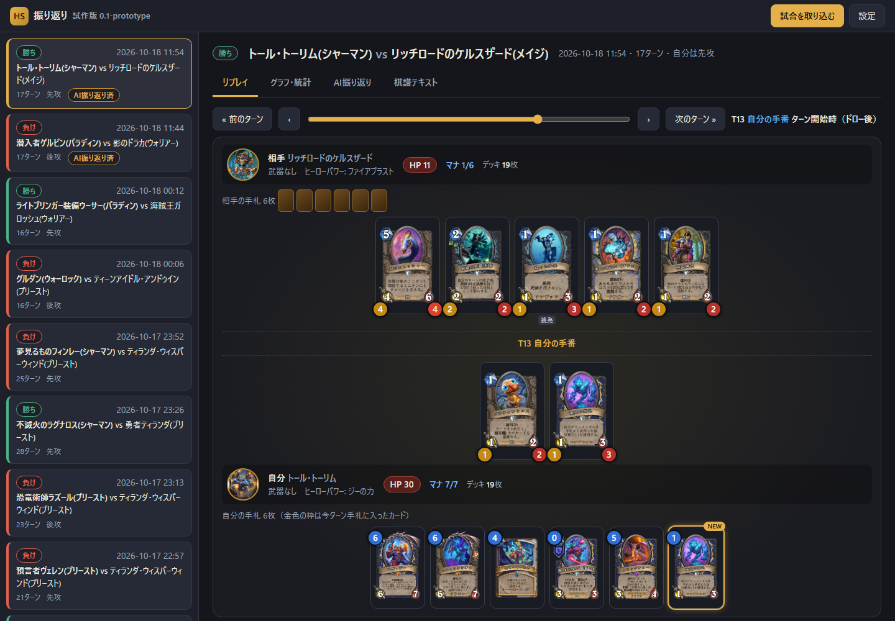
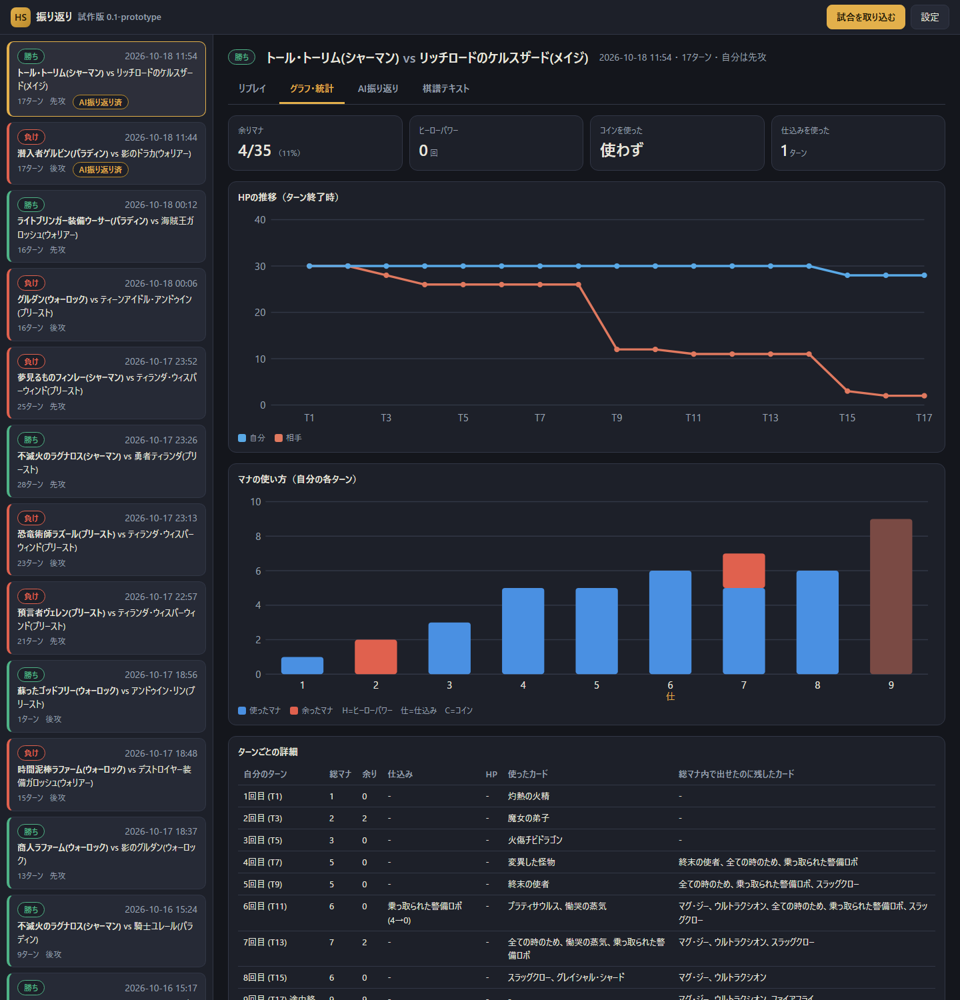
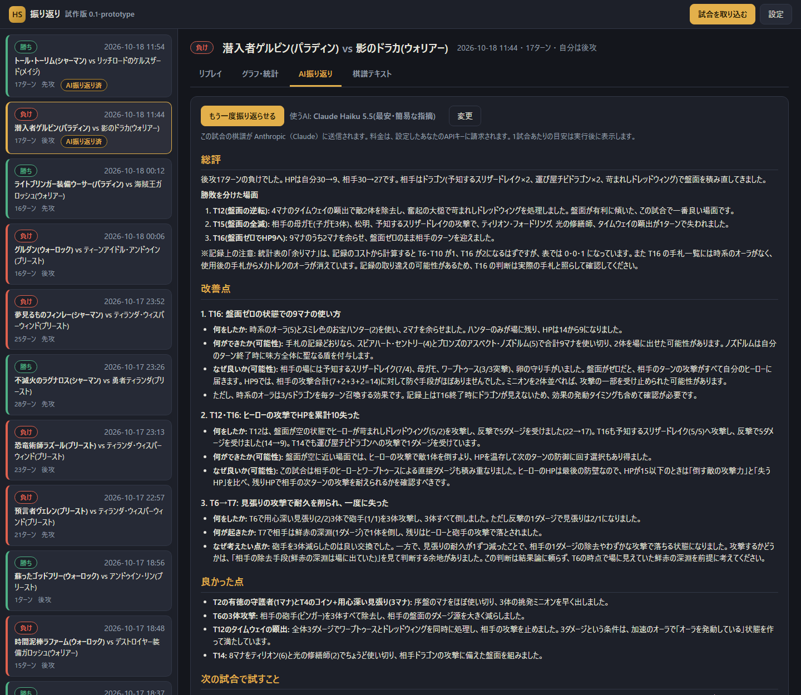

# hsreview — ハースストーン対戦の振り返りツール

ハースストーンの対戦後に、自分のプレイを振り返って「ここをこうすればよかった」を洗い出すためのツールです。
リアルタイムで助言するのではなく、**終わった試合を後からゆっくり見直す**ことを目的にしています。

ゲームが出力するログ(`Power.log`)を読んで、1試合ごとの「棋譜」(Markdown)と統計を作ります。
その棋譜を Claude などのAIに読ませて、改善点を洗い出してもらう使い方を想定しています。
**ログを読むだけで、ゲーム本体には触れません。** (Hearthstone Deck Tracker や Firestone と同じ方式です)

> 非公式のファンツールです。Blizzard Entertainment とは無関係で、承認も受けていません。
> Hearthstone は Blizzard Entertainment の商標です。

## 画面

**リプレイ** — カード画像つきの盤面を、ターンごとにコマ送りで見返せます。



**グラフ・統計** — HPの推移、マナの使い方(余らせたマナ・ヒーローパワー・コイン・仕込み)、ターンごとの詳細。



**AI振り返り** — 試合の記録をAIに渡して、改善点・良かった点・次に試すことを出してもらいます(利用者自身のAPIキーを使います)。



※画像は、作者自身のプレイ記録で作ったものです。カード画像・名称・効果の著作権はBlizzard Entertainmentにあります。

## できること

- ランク戦(スタンダード)の試合を、ログから自動で取り込む
- ターンごとの手札・盤面・HP・マナ、使ったカード、攻撃、死亡、発見の選択肢を時系列にまとめる
- 統計: ターンごとの余りマナ、ヒーローパワーの使用、コインを使ったターン、HP推移
- 登場したカードの効果テキスト(日本語)を棋譜に付ける。常にその試合のビルドのカードデータを使う
- 新しいキーワード(伝令・仕込み・合成など)を `knowledge/` に蓄積して、棋譜に注釈する

出力の例は [examples/sample_game.md](examples/sample_game.md) を見てください。

## 必要なもの

- Windows + Python 3.10 以上
- ハースストーン本体(ログ出力が有効であること)。Hearthstone Deck Tracker や Firestone を使っていれば、たいてい設定済みです。

## Windows版(インストーラー)

Pythonが入っていないPCでも使えます。インストーラー(`HSReview-Setup-x.y.z.exe`)を実行すると、スタートメニューに「HS振り返り」ができます。起動すると小さなウィンドウが出て、ブラウザで画面が開きます(ウィンドウを閉じると終了します)。

- 初回は、[注意事項・免責](docs/DISCLAIMER.md)への同意が必要です。
- APIキーは、Windowsの資格情報マネージャーに保存されます。
- 署名のないアプリのため、初回の実行時にWindowsが警告を出します。「詳細情報」→「実行」で起動できます。

自分でビルドする場合は、[ビルド手順](docs/BUILD.md)を見てください。

## アプリ(開発版): Pythonで動かす

```
python -m pip install -r requirements.txt
python app.py          # または start.bat をダブルクリック
```

ブラウザが開きます(自分のPCの中だけで動き、外部には公開されません)。

- **試合を取り込む**: ログから試合を取り込みます。初回はカードデータも自動で取得します。
- **リプレイ**: カード画像つきの盤面を、ターンごとに見返せます(← → キーでコマ送り)。
- **グラフ・統計**: HPの推移、マナの使い方、ターンごとの詳細、マリガン。
- **AI振り返り**: 試合の棋譜をAIに送り、改善点を出してもらいます。**料金は、設定した自分のAPIキー([Anthropic](https://console.anthropic.com/))に請求されます。** 棋譜が Anthropic に送信されます。キーが無い場合は、「棋譜テキスト」タブの「指示つきでコピー」で、お使いのAIに貼り付けても振り返れます。
- **設定**: APIキー、使うAIモデル、デッキの狙いのメモ、ログフォルダ、ログ出力の自動設定。

APIキーは `settings.json` に平文で保存されます(試作版)。このファイルは `.gitignore` で除外していますが、**他人に渡さないでください。**

## コマンドラインでの使い方

```

python hsreview.py sync          # 新しい試合を games/ に取り込む(ランク戦・スタンダードのみ)
python hsreview.py list          # 一覧
python hsreview.py show latest   # 最新の棋譜を表示 (ID / latest / 一覧の番号)
python hsreview.py stats         # 全試合の統計
python hsreview.py rebuild       # 保存済みの生ログから棋譜を作り直す
```

遊んだら `sync` で取り込んでください。ハースストーンは古いログを消すため、早めの取り込みをおすすめします。
取り込んだ試合は `games/` に保存されます(このフォルダは Git には含まれません)。

ログの場所が標準と違う場合は、`--logs` か環境変数 `HS_LOGS` で指定します。

```
python hsreview.py sync --logs "D:\Hearthstone\Logs"
```

### ログ出力の設定(初回のみ)

`%LOCALAPPDATA%\Blizzard\Hearthstone\log.config` に、次の内容が必要です。

```
[Power]
LogLevel=1
FilePrinting=true
ConsolePrinting=false
ScreenPrinting=false
Verbose=true
```

### AIに振り返ってもらう

[Claude Code](https://claude.com/claude-code) でこのフォルダを開いて、「直近の負けを振り返って」と頼むのが簡単です。
`CLAUDE.md` に手順と注意事項を書いてあるので、新しいセッションでもそのまま使えます。
`games/<ID>.md` を他のAIに貼り付けて頼むこともできます。

## 注意と限界

- ログに残るのは**自分に見えていた情報だけ**です。相手の手札やデッキは、使われたカードしか分かりません。
- ダメージ量などの細かい処理はログに書かれないため、ターン終了時の盤面とHPから読み取ります。
- 「出せたのに残したカード」などの統計は目安です。温存が正しい場面もあります。
- AIの指摘は参考です。最新セットの効果は、棋譜に付くカードテキストを根拠にします。
- 新しい用語の説明は `knowledge/keywords.json` にあります。確度(公式で確認 / ログから推定 / 未確認)を明記しているので、未確認のものは鵜呑みにしないでください。

## 注意事項・免責

使う前に、[注意事項・免責](docs/DISCLAIMER.md)をお読みください。要点は次のとおりです。

- 非公式のファンツールです。Blizzard Entertainment, Inc. とは無関係です。Hearthstone は Blizzard Entertainment, Inc. の商標または登録商標で、カードの名称・効果・画像の著作権も同社にあります。
- ログを読むだけで、ゲームには触れません。ただし、Blizzardの規約では、許可されていないソフトによるゲーム情報の読み取りを禁じる条項があります。**ご利用はご自身の判断と責任でお願いします。**
- 「AI振り返り」では、試合の棋譜が Anthropic に送信され、料金はあなたのAPIキーに請求されます。AIの指摘は間違うことがあります。

## プライバシー

- 生ログにはあなたのバトルタグが含まれます。`games/` は `.gitignore` で除外しています。**ログや `games/` を公開しないでください。**
- 棋譜(`.md`)には、バトルタグは出力されません。AIに渡す前に、念のため内容を確認してください。

## 使っているもの

- [python-hearthstone / hslog](https://github.com/HearthSim/python-hearthstone) (HearthSim) — ログの解析
- [HearthstoneJSON](https://hearthstonejson.com/) — カードデータ(起動時に自動取得。このリポジトリには含みません)

## ライセンス

MIT License(コードのみ)。カードの名前・効果テキスト・画像などの著作権は Blizzard Entertainment にあります。
